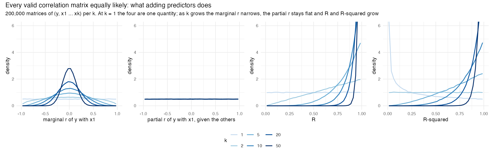

# Objective-bayes: what a default prior should keep flat

The argument behind [flatcor](https://github.com/dm-k1/flatcor), an R package
for objective Bayes factors and estimation in linear regression, and the
paper that makes it: why a choice of default prior is needed, what the
three candidate priors are, how they relate to the priors already in use,
and which to recommend.

> Define what's possible, not what you expect.

When a default Bayes factor tests one regression coefficient, the answer can
depend on how many other predictors are in the model. Whether it does depends
on what the default prior keeps flat as predictors are added.

With one predictor the answer is easy: a flat prior on the correlation. With
more, draw correlation matrices with every valid matrix equally likely and
watch what the number of predictors $k$ does. One quantity stays flat by
itself, the **partial correlation** of the outcome with each predictor; the
marginal correlation narrows, and the explained variance $R^2$ grows
([`docs/1_why_a_choice.md`](docs/1_why_a_choice.md)):

That leaves three candidate default priors, each flat on one quantity for
every $k$: **flat partial r** (what random matrices give; $R^2 \sim$
Beta($k/2$, 1)), **flat R** and **flat R²** (the total held fixed, so each
partial correlation narrows as $k$ grows).

## Three repositories

| Repository | What it holds |
|---|---|
| **Objective-bayes** (this one) | the argument and the paper: the introduction, the relation to other priors, the reading list, the motivating simulation |
| [**flatcor-validation**](https://github.com/dm-k1/flatcor-validation) | the statistics: the three priors and their derivations (the methods), and the validation that each works correctly within the Bayesian framework |
| [**flatcor**](https://github.com/dm-k1/flatcor) | the R package |

## Reading order

| | Document | Where | What it is |
|---|---|---|---|
| 1 | [`docs/1_why_a_choice.md`](docs/1_why_a_choice.md) | here | **Why a choice is needed**: what adding predictors does to valid correlation matrices, and the three intuitive choices of what stays flat |
| 2 | [`docs/2_the_three_priors.md`](https://github.com/dm-k1/flatcor-validation/blob/main/docs/2_the_three_priors.md) | flatcor-validation | **The three priors**: the family $R^2 \sim$ Beta($a$, 1), what each keeps flat and expects, what the package computes |
| 3 | [the validation](https://github.com/dm-k1/flatcor-validation) | flatcor-validation | **Does each prior work?** Six studies, and what each tests |
| A | [`docs/appendix/A_derivations.md`](https://github.com/dm-k1/flatcor-validation/blob/main/docs/appendix/A_derivations.md) | flatcor-validation | The derivations: the density, the Stan model, the Bayes factors, the default-prior criteria |
| B | [`docs/appendix/B_relation_to_other_priors.md`](docs/appendix/B_relation_to_other_priors.md) | here | How the three relate to JZS, `stan_lm`, R2-D2 and other priors; what is new here and what is not |
| | [`docs/reading_list.md`](docs/reading_list.md) | here | What to read, and why |
| | the paper | here, **to be written** | The results of the validation and the recommendation |

## Open questions

- **The empirical question between the priors:** how explained variance grows
  with the number of predictors in published regressions. Flat partial r
  predicts a median $R^2$ of .76 with 5 predictors; flat R predicts .25 and
  flat R-squared .50 at any size.
- **How the priors behave in use**, a later study: how often the test of a
  term finds an effect, confirms a null or stays undecided as $k$ and $n$
  change, and how well the estimates do.
- **Benchmarks in variable selection** against the robust, hyper-g/n and
  intrinsic priors (BAS package), and a reanalysis of real data.

## What's where

| Path | What it is |
|---|---|
| `docs/1_why_a_choice.md` | Part 1 of the reading path |
| `docs/appendix/B_relation_to_other_priors.md` | Appendix B |
| `docs/reading_list.md` | The reading list |
| `docs/figures/` | The figures of part 1 |
| `R/motivating_simulation.R`, `R/helpers.R` | The motivating simulation (random correlation matrices; no Stan needed) |
| `R/make_figures.R` | Figures 1 and 2 of part 1, and the checks printed for part 1 and appendix B |

Both scripts need [flatcor](https://github.com/dm-k1/flatcor)
(`remotes::install_github("dm-k1/flatcor")`) and ggplot2, patchwork; run them
from this folder (`Rscript R/motivating_simulation.R`).

## History

These files come from the repository that is now
[flatcor-validation](https://github.com/dm-k1/flatcor-validation), with their
git history: the argument and the validation grew up together there until
November 2026, when the paper side moved here.

## Author

Diemithry M. Kloppenburg, University of Amsterdam.

## License

MIT (`LICENSE.md`).
